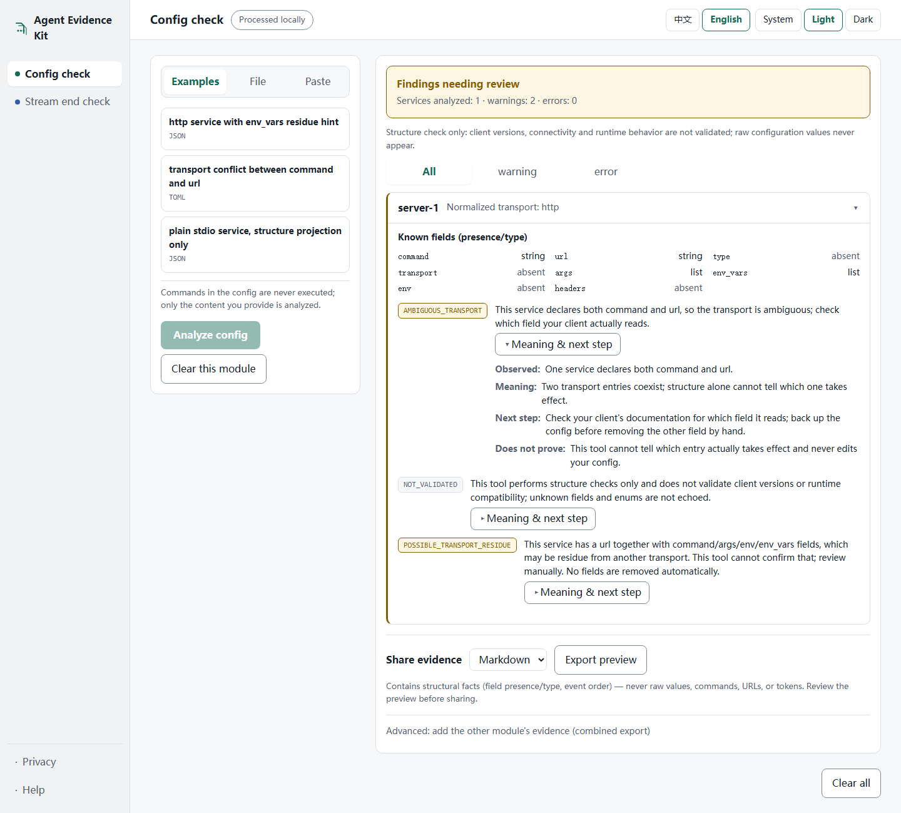
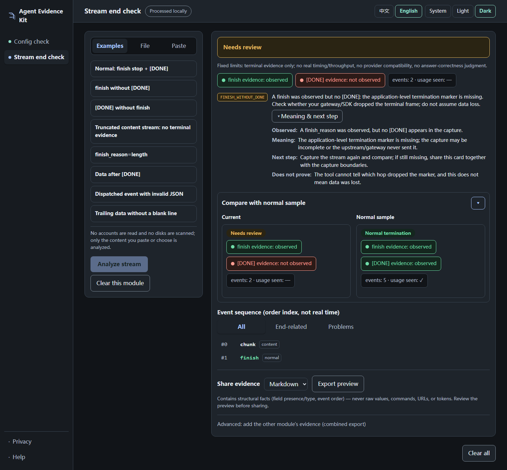

# Agent Evidence Kit

[English](README.md) · [简体中文](README.zh-CN.md)

**Share the evidence. Keep the raw data.**

Turn MCP configurations and captured chat-completions SSE streams into
structure-only evidence cards for bug reports. Run checks locally, then
review and share the evidence — without uploading your raw input.

## Why use it?

- **Share useful facts, keep private values out.** Reports contain field
  presence/types and stream event order; commands, URLs, credentials,
  generated text and tool arguments stay out of the evidence.
- **No model calls or API key.** Deterministic checks run on the content
  you provide, with fixed bilingual guidance and explicit limits on what
  each finding proves.
- **Check before sharing.** Preview Markdown or JSON before copying or
  downloading. Clear shows whether the local service confirmed removal
  of session results.
- **A workflow for users and maintainers.** A local web workspace and CLI
  produce the same evidence, in English or Chinese, ready to attach to
  an issue. No telemetry or third-party upload.



## What it does

Two bounded checkers in one local tool:

- **Config check** — paste or drop an agent MCP server configuration
  (`.json` / `.toml`, ≤256 KiB). Get a structure-only evidence card:
  per-server transport facts (presence/type — never values), transport
  conflicts, migration residue, field-type problems, each with an
  *Observed / Meaning / Next step / Does not prove* breakdown.
- **Stream end check** — paste or drop a captured chat-completions SSE
  stream (`.sse` / `.txt`, ≤8 MiB). Check the captured terminal evidence: was a
  `finish_reason` observed, was `[DONE]` received, truncation,
  `length`/`content_filter` stops, upstream errors, data after `[DONE]` —
  with a normal-termination sample side by side and a 50-per-page event
  sequence.



Everything runs in this workspace (light/dark/system theme, English or
中文): click a sample to try the real pipeline — no API key and no
access to external networks.

## Quick start (from a source checkout)

```bash
git clone https://github.com/xiaofeilovecoding/agent-evidence-kit
cd agent-evidence-kit

# Windows (PowerShell)
py -3 -m venv .venv                       # needs Python 3.11+
.\.venv\Scripts\Activate.ps1
python -m pip install -e ".[web]"
python -m agent_evidence_kit web

# macOS / Linux
python3 -m venv .venv                     # needs Python 3.11+
. .venv/bin/activate
python -m pip install -e ".[web]"
python -m agent_evidence_kit web
```

The web UI opens at `http://127.0.0.1:7411` and needs **no Node.js** —
the interface ships pre-built inside the package. Once the package is
published on PyPI, `pip install "agent-evidence-kit[web]"` becomes the
fastest entry; until then the checkout above is the supported install.

CLI, same cores and exit codes:

```bash
python -m agent_evidence_kit config --input config.toml --format md --lang en
python -m agent_evidence_kit stream --input capture.sse --format json
python -m agent_evidence_kit stream demo --case finish-only
```

## Compare a healthy stream against a failing one

Two captured streams, one command — the comparison shows what actually
differed between them, terminal evidence first:

```bash
python -m agent_evidence_kit stream compare --baseline normal.sse --candidate failed.sse --format md
```

Real output for two synthetic captures (a normal termination vs an upstream
error; exit code 1 because differences were observed):

```markdown
# Stream end comparison: baseline vs candidate

- Baseline: NORMAL_TERMINATION · finish_reason (controlled enum): stop · [DONE] seen: yes
- Candidate: UPSTREAM_ERROR · finish_reason (controlled enum): none (no finish observed) · [DONE] seen: none

## Terminal differences

- **Terminal state**: NORMAL_TERMINATION → UPSTREAM_ERROR
  - NORMAL_TERMINATION: A normal finish was observed and [DONE] was received: terminal evidence is complete for this profile. This does not prove the answer is correct or complete.
  - UPSTREAM_ERROR: The stream contains an upstream error event (the error body is never echoed).
- **Verdict**: NORMAL_TERMINATION → NEEDS_REVIEW

## Diagnostic differences (expanded)

- **finish_reason (controlled enum)**: stop → none (no finish observed)
- **[DONE] seen**: yes → none
- **Terminal event index**: @event2 → not observed
- **Diagnostic codes**: NORMAL_TERMINATION → UPSTREAM_ERROR
  - [candidate] UPSTREAM_ERROR: The stream contains an upstream error event (the error body is never echoed).
- **Event count**: 4 → 2

> The differences above are observations between the two captured streams; this comparison does not prove upstream root causes.
```

The comparison reads the two structure projections only: event data,
generated text, tool arguments, unknown reason text, addresses, session
ids and file names never enter the output, and an unknown `finish_reason`
is bucketed to `other` instead of being echoed. The web UI has the same
comparison on the Stream page (expand "Baseline vs candidate compare",
paste both sides or load the two synthetic samples, then compare and
share); the static showcase pages keep showing single-sample cards and
label the comparison as available in the local CLI / web app.

## Three problems it answers

1. **"My config changed and a service broke"** — check the config for
   transport conflicts and migration residue; each finding says what was
   observed, what it means, what to do next, and what it cannot prove.
2. **"The stream just ended and I don't know why"** — check whether the
   capture shows a `finish`, a `[DONE]`, both, or neither; the card
   separates the two signals instead of guessing.
3. **"What does a healthy stream look like?"** — every result has a
   normal-termination sample to compare against (config ships a plain
   structure sample too).

All samples are synthetic fixtures run through the same real cores as
your own input — nothing is faked per sample.

## What evidence contains — and what it never contains

An evidence card or export **contains only**: field presence/type, event
order and kinds (chunk/finish/done), stable finding codes with fixed
bilingual explanations and next-step guidance, and fixed scope
statements.

It **never contains**: server names, commands, URLs, env names or values,
model output text, tool arguments, ids, hashes, raw errors, or stack
traces. Even the structural facts it does show (service count, transport
types, event counts) are worth a look before you share — the preview is
the exact bytes of the copy/download.

## Privacy: processed locally, verifiably

- Raw input lives only in your input control (that display is expected)
  and in temporary parse memory on this machine. The local service keeps
  a bounded structural projection in memory; temporary memory is not
  secure erasure.
- No third-party upload, no telemetry, no remote fonts. The only
  persisted data is your language/theme preference.
- The **Processed locally** button in the app opens the four-step data
  path panel so you can verify the claim instead of trusting a badge.
- Copying/downloading is your explicit action and leaves the session —
  downloads and clipboard are not affected by Clear.
- Installing dependencies and opening documentation links touch the
  network, only on your explicit action.

## Not a fit for

- Runtime debugging of a live agent: this tool makes no outbound
  connections and sends no requests, and it reads no files beyond the
  one you give it.
- Judging whether an answer is correct, or provider compatibility.
- Automatic fixes: findings come with human next-steps; your config is
  never modified.

## Feedback

Issues and discussion live in the repository's
[issue tracker](https://github.com/xiaofeilovecoding/agent-evidence-kit/issues).
Security-sensitive reports: see [SECURITY.md](SECURITY.md) — please do
not open public issues for them.

## Development

```bash
python -m unittest tests.test_config_core tests.test_stream_core tests.test_next_steps -v
pip install -e ".[web]" httpx
python -m unittest tests.test_web tests.test_clear_race tests.test_export_races -v
python scripts/build_frontend.py          # locked npm ci + both builds + asset sync
python -m unittest tests.test_browser tests.test_review_fixes tests.test_public_ready -v
python scripts/capture_screenshots.py     # regenerate README screenshots from the build
```

Browser tests need Playwright Chromium
(`pip install playwright && python -m playwright install chromium`, or set
`PLAYWRIGHT_BROWSERS_PATH` to an existing cache). See
[CONTRIBUTING.md](CONTRIBUTING.md). 中文说明：[README.zh-CN.md](README.zh-CN.md)。

## Status & license

Version 0.2.0, experimental candidate. MIT — see [LICENSE](LICENSE).
