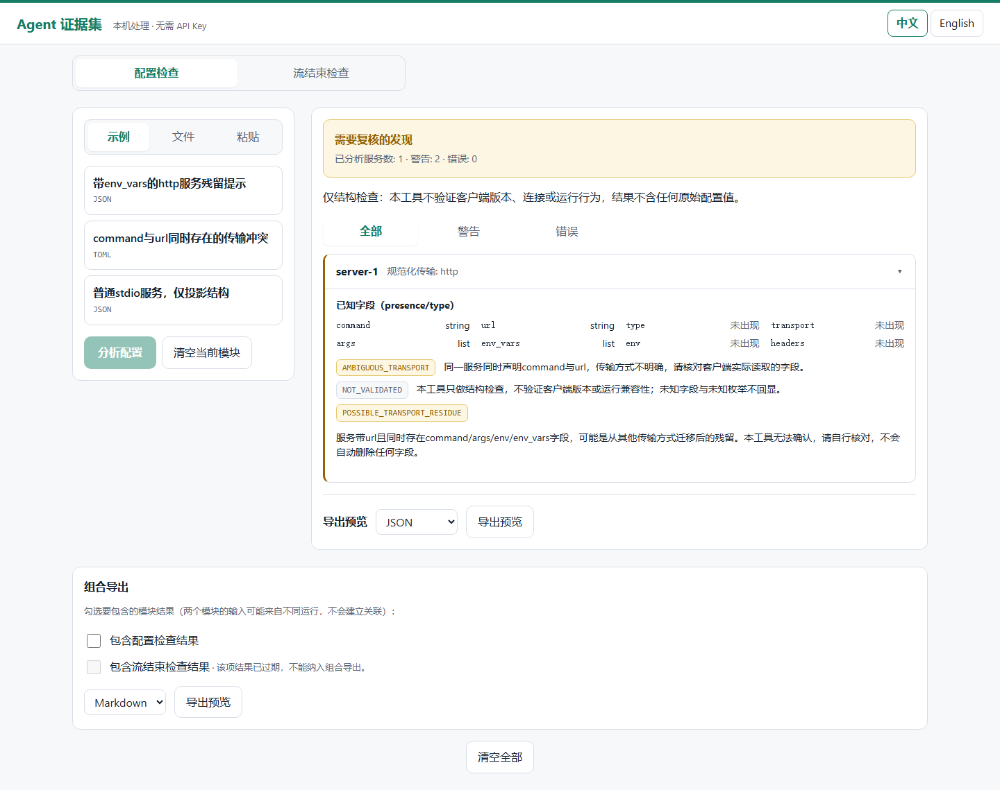
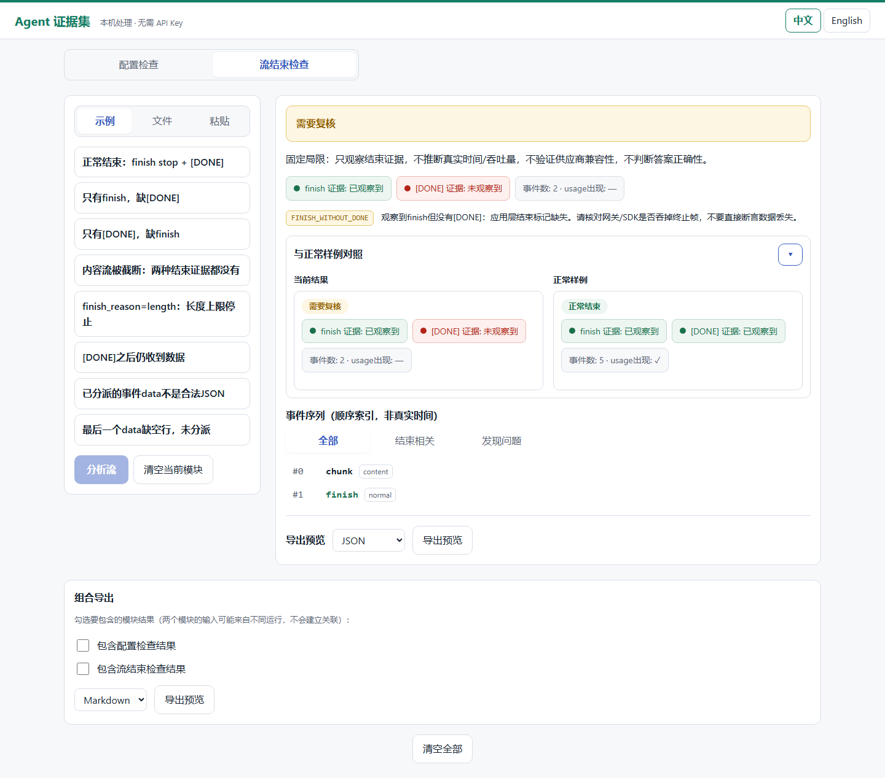
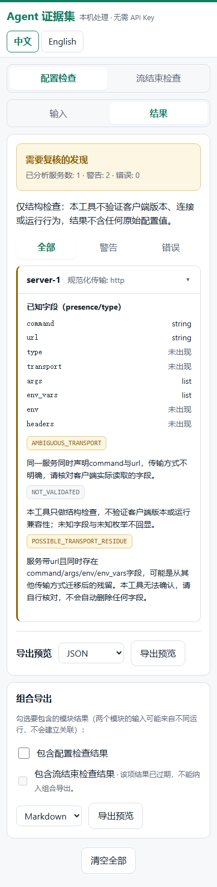

# Agent Evidence Kit（Agent 证据集）

本地秒级生成匿名、可分享的排障证据——不上传任何内容。

一个工具内含两个有界诊断模块：

- **配置检查** — 粘贴或拖入 agent 的 MCP 服务配置（`.json` / `.toml`，≤256KiB），得到仅结构层面的证据卡：每个服务的传输事实（presence/type，绝不含值）、传输冲突与迁移残留警告、稳定的发现码。
- **流结束检查** — 粘贴或拖入抓包的 chat-completions SSE 流（`.sse` / `.txt`，≤8MiB），得到结束证据：是否观察到 `finish_reason`、是否收到 `[DONE]`、流被截断、`length`/`content_filter` 停止、上游错误、`[DONE]` 之后仍有数据——并提供正常结束样例对照。

可以只用一个模块；两个结果可合并导出为一份 Markdown/JSON，适合作为匿名 Issue 附件。工具从不假设两个输入来自同一次运行，也不建立关联。

## 为什么

Agent 出问题时，最快的帮助来自分享证据——但配置和流抓包里全是秘密（命令、URL、token、对话文本）。Agent Evidence Kit 把任一输入转换为确定性投影，只包含**固定常量与结构事实**：无服务名、无命令、无 URL、无 token、无模型输出文本、无哈希、无原始错误。分享证据卡，留下秘密。



## 30秒演示（从源码检出运行、无 Key）

```bash
git clone <repository-url> && cd agent-evidence-kit   # 仓库地址在公开发布时提供
pip install -e ".[web]"
python -m agent_evidence_kit web                      # 打开 http://127.0.0.1:7411
```

正式发布到 PyPI 后，`pip install "agent-evidence-kit[web]"` 将是最快入口；在此之前以上源码方式为受支持安装。



[English](README.md)

点击任一内置合成样例（配置或流），查看证据卡并导出。一切都在本机完成：无 API Key、无遥测、无网络访问。

## CLI

```bash
python -m agent_evidence_kit config --input config.toml --format md --lang en
python -m agent_evidence_kit stream --input capture.sse --format json
python -m agent_evidence_kit stream demo --case finish-only
python -m agent_evidence_kit web --no-open --port 7411
```

每个模块退出码：`0` 正常 / `1` 有发现需复核 / `2` 输入无效。相同输入下 Web 与 CLI 产出完全一致的卡片。

## 隐私模型

- 原始值从不被渲染、存储、记录或导出——只有 presence/type/kind 事实和固定解释文案。
- 所有上限（配置 256KiB / 流 8MiB、深度、行、事件数）都在实际读取的字节上强制执行；超深嵌套输入以稳定错误拒绝，不会崩溃或泄漏路径。
- Web UI 只绑定 `127.0.0.1`，使用 HttpOnly `SameSite=Strict` 会话并带 CSRF 与精确同源校验（拒绝同站异端口），空闲 30 分钟 / 绝对 8 小时过期，仅存储有界投影。
- 确定性：相同输入 + 语言 + 格式 → 字节级一致的输出。



## 不适用的场景

- 对运行中的 agent 做实时调试（本工具从不连接任何服务、发送请求，也不读取你提供的文件之外的日志）。
- 判断答案是否正确，或供应商兼容性。
- 自动修复——发现附带解释，但不会修改你的任何配置。

## 开发

```bash
git clone <repo> && cd agent-evidence-kit
python -m unittest tests.test_config_core tests.test_stream_core -v   # 双核心（仅标准库）
pip install -e ".[web]" httpx && python -m unittest tests.test_web -v  # HTTP 层
python scripts/build_frontend.py                                       # 构建并同步 Web 资产
python -m unittest tests.test_browser -v                               # 真实浏览器用例
```

前端：React + TypeScript + Vite（`frontend/`）；本地 UI 由构建脚本同步到 Python 包（`agent_evidence_kit/_web_static`）供服务端直接使用。另有静态样例展示构建（`npm run build:showcase`），不调用任何 API。见 [CONTRIBUTING.md](CONTRIBUTING.md) 与 [SECURITY.md](SECURITY.md)。

## 状态

实验性候选产品。两个模块由早期单一用途原型（Agent 诊断卡、Stream End Lab）整合而来；各模块证据卡 schema 独立版本化。

## 许可

MIT — 见 [LICENSE](LICENSE)。
