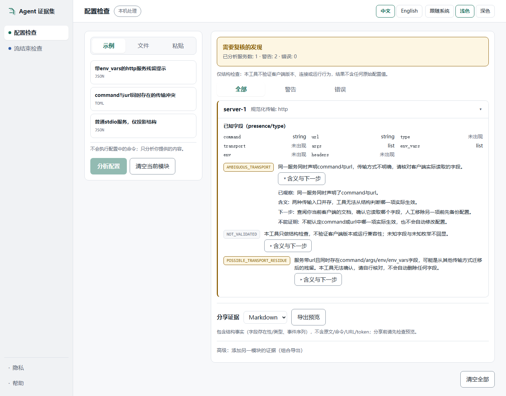
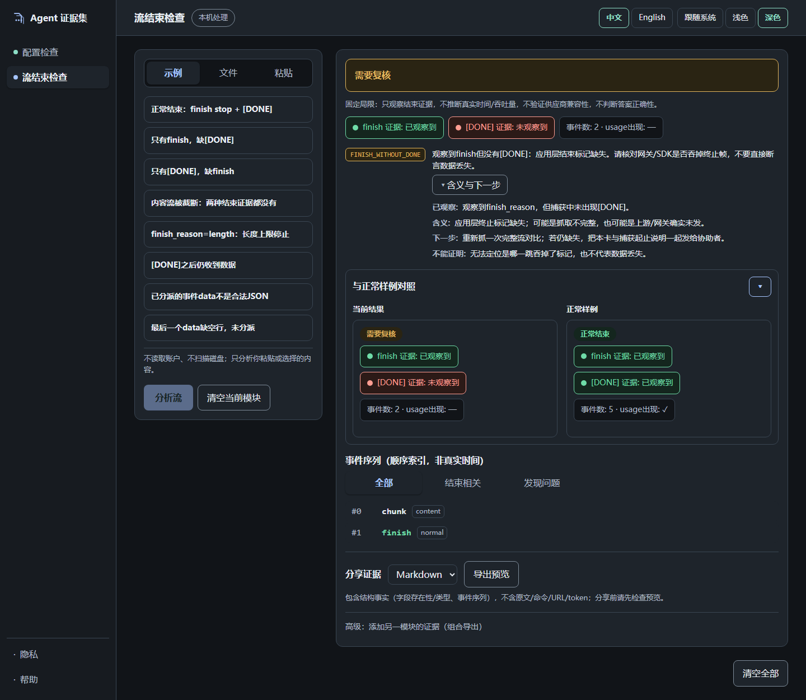

# Agent Evidence Kit（Agent 证据集）

**分享证据，保留原文。**

本地、可核查隐私的 Agent 排障证据卡：MCP 服务器配置结构检查 + 已捕获 LLM 流结束证据检查。确定性输出、中英双语、可导出——无需 API Key、无遥测、无上传。



## 它做什么

一个本地工具内含两个有界检查器：

- **配置检查** — 粘贴或拖入 agent 的 MCP 服务器配置（`.json` / `.toml`，≤256KiB）。得到仅结构层面的证据卡：每个服务的传输事实（presence/type，绝不含值）、传输冲突、迁移残留、字段类型问题；每条发现附*已观察 / 含义 / 下一步 / 不能证明*四段说明。
- **流结束检查** — 粘贴或拖入抓包的 chat-completions SSE 流（`.sse` / `.txt`，≤8MiB）。得到结束证据：是否观察到 `finish_reason`、是否收到 `[DONE]`、流被截断、`length`/`content_filter` 停止、上游错误、`[DONE]` 后残留数据——与正常结束样例左右对照，事件序列按 50 条/页分页。



全部在同一个工作区内完成（浅色/深色/跟随系统主题，中文或 English）：点击任一示例即可体验真实诊断链——无需 API Key、不访问外部网络。

## 快速上手（从源码检出运行）

```bash
git clone https://github.com/xiaofeilovecoding/agent-evidence-kit
cd agent-evidence-kit

# Windows (PowerShell)
py -3 -m venv .venv                       # 需要 Python 3.11+
.\.venv\Scripts\Activate.ps1
python -m pip install -e ".[web]"
python -m agent_evidence_kit web

# macOS / Linux
python3 -m venv .venv                     # 需要 Python 3.11+
. .venv/bin/activate
python -m pip install -e ".[web]"
python -m agent_evidence_kit web
```

Web UI 在 `http://127.0.0.1:7411` 打开，**无需 Node.js**——界面已预构建并随包分发。包正式发布到 PyPI 后，`pip install "agent-evidence-kit[web]"` 将是最快入口；在此之前以上源码方式为受支持安装。

CLI 与 Web 使用相同核心和退出码：

```bash
python -m agent_evidence_kit config --input config.toml --format md --lang en
python -m agent_evidence_kit stream --input capture.sse --format json
python -m agent_evidence_kit stream demo --case finish-only
```

## 它回答三个问题

1. **“配置改完服务就不工作了”** — 检查配置中的传输冲突与迁移残留；每条发现说明已观察什么、含义、下一步怎么做、不能证明什么。
2. **“流突然结束，原因不明”** — 检查抓包里有没有 `finish`、有没有 `[DONE]`、还是两者皆无；证据卡把两个独立信号分开呈现，不靠猜。
3. **“一条正常的流长什么样”** — 每个结果都有正常结束样例可对照（配置模块也提供普通结构样例）。

所有样例都是合成 fixture，走与你自己的输入完全相同的真实核心——不伪造任何结果。

## 证据包含什么——从不包含什么

证据卡与导出**只包含**：字段 presence/type、事件顺序与类型（chunk/finish/done）、稳定的发现码与固定双语解释及下一步建议、固定的范围声明。

**从不包含**：服务名、命令、URL、env 名或值、模型输出文本、tool 参数、id、哈希、原始错误或堆栈。即便它显示的结构事实（服务数、传输类型、事件数）也值得在分享前看一眼——预览即复制/下载的字节内容。

## 隐私：本机处理，可核查

- 原文只存在于你正在使用的输入控件中（这是预期显示），以及本机临时解析内存。本地服务只保留有界的结构投影在内存中；临时内存不是安全擦除。
- 无第三方上传、无遥测、无远程字体。唯一持久化数据是你的语言/主题偏好。
- 应用内 **“本机处理”** 按钮可打开四步数据路径面板，核实这句话而不是相信徽章。
- 复制/下载是你主动离开会话的动作——下载文件与剪贴板不受“清空”影响。
- 安装依赖与打开文档链接会联网，均需你主动操作。

## 不适用的场景

- 对运行中的 agent 做实时调试：本工具不发起任何对外连接、不发送请求，也不读取你提供的文件之外的日志。
- 判断答案是否正确，或供应商兼容性。
- 自动修复：发现附带人工下一步说明；你的配置绝不会被修改。

## 反馈

问题与讨论请到仓库
[issue tracker](https://github.com/xiaofeilovecoding/agent-evidence-kit/issues)。安全相关报告见 [SECURITY.md](SECURITY.md)——请勿以公开 issue 提交。

## 开发

```bash
python -m unittest tests.test_config_core tests.test_stream_core tests.test_next_steps -v
pip install -e ".[web]" httpx
python -m unittest tests.test_web tests.test_clear_race tests.test_export_races -v
python scripts/build_frontend.py          # 锁定 npm ci + 双构建 + 资产同步
python -m unittest tests.test_browser tests.test_review_fixes tests.test_public_ready -v
python scripts/capture_screenshots.py     # 从生产构建重新生成 README 截图
```

浏览器测试需要 Playwright Chromium（`pip install playwright && python -m playwright install chromium`，或设置 `PLAYWRIGHT_BROWSERS_PATH` 指向已有缓存）。见 [CONTRIBUTING.md](CONTRIBUTING.md)。English: [README.md](README.md)。

## 状态与许可

版本 0.2.0，实验性候选。MIT — 见 [LICENSE](LICENSE)。
